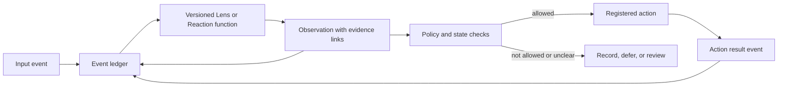

# REFLEX guide

REFLEX is a local event-driven framework for turning incoming records into reviewable findings and controlled next steps. It keeps the original events, the method that produced a finding, the policy decision, and any action result connected so a person can inspect the full trail.

This guide explains the two main workflows in the project:

- **Reactions** connect events to registered functions, state, policies, and possible actions. The synthetic news demo is the easiest example.
- **Discovery runs** build features from event history, fit or apply Lenses, and evaluate findings. The synthetic discovery demo and experiment commands use this path.

These are related parts of REFLEX, but they answer different questions. A Lens detects or summarizes a pattern. A Reaction defines what workflow follows an event. A finding does not, by itself, authorize an action.

## Start here

The project supports Python 3.12 through 3.14. The examples below use `uv` and Python 3.13.

```bash
uv sync --python 3.13 --extra dev
uv run reflex --help
uv run reflex experiments demo-news --out .reflex-news-demo
```

The news demo uses synthetic stories, a synthetic portfolio, and a local simulated publisher. It does not connect to a live portfolio or messaging service. Its output includes a JSON run report, an event database, and a state database in `.reflex-news-demo/`.

For a complete statistical discovery example, run:

```bash
uv run reflex experiments discovery demo --out .reflex-demo --seed 11
```

This generates synthetic events, fits or loads statistical Lenses, scores later windows, saves observations, and writes `latest-run.json`. By default, its evaluator labels are written to the sibling folder `.reflex-demo-evaluator/`. Keep that evaluator folder out of an agent's input workspace when you are measuring label-blind performance.

## Reusable core and experiment profiles

The reusable core works with normalized `Event` records, caller-defined feature rows, stores, SQL lenses, model fitting, and policy. It does not assume a transaction schema. The `experiments` package holds dataset readers, synthetic labels, transaction-specific features, sample SQL profiles, and benchmark commands.

Use `reflex replay --sql-file lens.sql` to run a SQL lens you define. Use `reflex experiments transaction-replay` for the prepared transaction example. Likewise, dataset readers are under `reflex experiments ingest-bpi` and `reflex experiments ingest-loghub`. Compatibility aliases remain, but new code and examples should use the namespaced commands.

## The mental model



| Term | In plain language | Example |
|---|---|---|
| **Event** | A dated record of something that happened. Saved events are not edited in place. | A `news.story` event or a payment status update. |
| **Event ledger** | The ordered history of input events and later derived events. | DuckDB stores input events, observations, action requests, and action results. |
| **Lens** | A named, versioned method that looks for a pattern. | A SQL threshold or a statistical anomaly detector. |
| **Observation** | A Lens result with its subject, time window, result, and supporting event IDs. It is a finding, not automatically a verified fact. | “Exposure rose in this window,” linked to the events used to calculate it. |
| **Policy** | A rule that decides whether to record, investigate, defer, or take another permitted route. | Defer an investigation when the run has used its investigation budget. |
| **Reaction** | A versioned workflow graph that connects event types, registered functions, conditions, state, and output events. | Understand a story, check portfolio exposure, and create an alert only when relevant. |
| **Action event** | A request to call a specific registered function with named arguments and a required permission. | Request a simulated portfolio notification. |
| **Action result** | A separate event recording whether an action attempt succeeded or failed. Replay skips are recorded in execution state and the run record. | Record that a simulated alert was delivered after one retry. |
| **State** | Versioned information used by later workflow steps. Changes are accompanied by an audit reason and time. | The current synthetic portfolio or a candidate Lens status. |
| **Replay** | Run recorded inputs through the workflow again to inspect or reproduce behavior. External side effects are skipped during replay. | Recompute which event IDs a Reaction would emit without sending another notification. |

## A complete example: synthetic portfolio news

`reflex experiments demo-news` is the best place to see how a Reaction connects the pieces. The demo creates a fixed portfolio and several synthetic story events. One example input has this shape:

```python
from datetime import datetime, timezone

from reflex.core.models.events import NativeEvent


NativeEvent(
    event_id="news-100-initial",
    event_type="news.story",
    event_time=datetime(2026, 1, 12, 9, tzinfo=timezone.utc),
    entity_ids=("NORTHSTAR",),
    source="synthetic:portfolio-news",
    schema_ref="portfolio.news-story@1.0",
    payload={
        "story_id": "news-100",
        "revision": 0,
        "headline": "Northstar raises its earnings outlook",
        "companies": ["NORTHSTAR"],
        "themes": ["earnings", "guidance"],
    },
)
```

The real demo also includes fields such as a correlation ID, provenance, and an idempotency key. The example above is shortened to show the important parts.

The Reaction then follows this path:

1. **The event is saved.** Its event ID, timestamp, source, entity, and payload are kept in the event ledger.
2. **The workflow matches it.** The `portfolio_news_intelligence@1.0` Reaction subscribes to `news.story` events. The runtime checks the declared input schema and resolves the registered function by name and version.
3. **A Lens function creates an observation.** `news-understanding@1.0` records story details as an `observation.news_understanding` event. `portfolio-exposure@1.0` compares the mentioned companies with the saved portfolio and emits an `observation.portfolio_exposure` event.
4. **The workflow follows declared edges.** The exposure observation can go to the investigation function and to the notification policy function. A story about an unheld company is recorded, but does not create a portfolio alert.
5. **A permitted action may run.** For a relevant story, the policy function can create an `ActionEvent`. The action executor checks that its function is registered, that the declared permission matches, and that any configured argument schema passes.
6. **The result is saved.** The simulated publisher returns a structured result. REFLEX records it as an action-result event linked to the action request. The demo makes the first attempt for one story fail once, then succeed on its allowed retry.

The same demo also shows duplicate suppression, a new story revision, a manager response, and a possible supplier relationship recorded as an **unverified hypothesis**. Replaying the saved inputs checks the same workflow path while avoiding another external side effect. In this demo, the publisher is an in-memory function, so there is no real external message.

The graph and its registered functions are assembled in `src/reflex/experiments/news_demo.py`. The runtime that validates and runs the graph is in `src/reflex/runtime.py`.

## Events, observations, and evidence

An event has a stable identity and a timezone-aware event time. Its shared envelope can also include entity IDs, source, attributes, payload, provenance, parent event IDs, schema reference, correlation ID, causation ID, and idempotency key.

There are distinct event types for the main roles:

- `NativeEvent` represents an event received from an external or synthetic source.
- `ObservationEvent` represents a Lens finding written to the ledger.
- `ActionEvent` represents a request to call an allowlisted function.
- `ActionResultEvent` records what happened when the request was attempted.

The separate `Observation` model holds the Lens result before or alongside its ledger representation. It carries the Lens ID and version, subject, time window, result value, supporting event IDs, state snapshot, quality details, and provenance. `Observation.as_event()` turns it into an `ObservationEvent` whose parent IDs point back to its evidence.

For example, an observation about `acct-0012` might refer to events `evt-101` and `evt-118`. A reviewer can follow those IDs to inspect the source activity and check whether it supports the finding. REFLEX records this lineage; it does not guarantee that evidence is causally sufficient.

## Lenses and statistical discovery

The project has deterministic and statistical discovery paths:

- The **SQL Lens** runs one bounded `SELECT` or `WITH` query through the local event-store adapter. A high-amount example query is an experiment profile, not a core default. The SQL checks are local guardrails, not a hardened multi-tenant sandbox.
- The **statistical discovery** path builds entity-window features, fits versioned model artifacts, calibrates thresholds on a separate time interval, then scores later events. Artifacts record details such as the seed, feature names, training cutoff, and signatures of the data used.

The synthetic transaction profile has a chronological training, calibration, and later evaluation period. The model should not learn from the later evaluation interval. The `demo` command can pass the separate evaluator labels to score results after observations are produced. To keep a discovery run label-blind, generate the data and then run `run` without `--evaluator-dir`:

```bash
uv run reflex experiments discovery generate --out .reflex-data --seed 11 --entities 80 --days 30
uv run reflex experiments discovery run --data-dir .reflex-data
```

The generated input directory contains the event database and dataset manifest. The evaluator labels live in the sibling `.reflex-data-evaluator/` directory by default. Do not give that directory to an adapter that is meant to operate without labels.

The multi-scenario experiment runner covers six synthetic cases:

1. **Exposure drift:** gradual exposure change before a static limit is crossed.
2. **Collateral deterioration:** several moderate feature changes combine into stress.
3. **Rare sequence:** an ordered chain of events matters more than any one event alone.
4. **Correlation shift:** the relationship between two features changes while their individual distributions stay similar.
5. **Spurious confounder:** an apparent relationship breaks and a different driver becomes relevant.
6. **Unseen mechanism:** a new partner/channel interaction appears after the training period.

These generators provide known, synthetic mechanisms for checking the pipeline. They are useful for controlled experiments, but do not stand in for independently collected and labeled operational data.

## Policy, investigation, and action safety

The discovery `PolicyEngine` currently makes a deterministic decision from an observation and a run budget:

- A finding that is not flagged is retained as `record`.
- A flagged finding is sent to investigation while budget remains.
- A flagged finding is `defer`red when the investigation budget is exhausted.

The local `LocalInvestigator` uses bounded tools to inspect observations, query a limited number of source events, inspect state, compare cohorts, and record rival hypotheses. It is a deterministic local fallback; it does not use an LLM and it does not validate causal explanations.

The Reaction action boundary has separate controls. A function must be registered before it can run. An action carries its required permission and retry limit. The Reaction provides the permissions it is allowed to use, and the action executor checks them against the registered function. Schema checks can validate the arguments and result. The workflow also has maximum step, output, and retry limits.

These controls are part of the local framework; they are not a full identity, secrets, or approval service. If a real deployment requires human approval, that approval needs to be represented and enforced by the host application or a specific review step. The synthetic demo’s configured permission is not a live user identity check.

## State, storage, and replay

REFLEX uses separate local stores for different kinds of records:

- **DuckDB event store:** native events, observations, action requests, and action results. Event IDs are unique; an identical duplicate is ignored, while conflicting content under the same ID is rejected.
- **SQLite state store:** named state namespaces, state versions, audit entries, run records, budgets, and Lens-candidate transitions.
- **Artifact files:** statistical model manifests and model data are stored with the discovery run.

State snapshots can be captured with Reaction runs. The run record includes the Reaction and version, trigger event, function versions, emitted event IDs, state snapshot and hash, status, errors, and timestamps. This makes it possible to understand what the workflow saw and produced.

Replay is useful for repeatability and debugging, but its mode matters. The runtime uses saved inputs and state to reproduce decisions; the action executor reuses a prior successful result or skips the side effect on a replay path. Replay should not be treated as a mechanism for safely retrying a real external action. A real retry should be an explicit new action governed by the host's retry and approval rules.

## Command guide

All workflows use the single `reflex` command. Start with `uv run reflex --help`, or add `--help` after a command group for its available options.

| Command | What it does | Example |
|---|---|---|
| `experiments discovery demo` | Generates transaction-shaped synthetic events, runs discovery, and optionally scores evaluator labels after scoring. | `uv run reflex experiments discovery demo --out .reflex-demo --seed 11` |
| `experiments discovery generate` | Creates the transaction experiment input and separate evaluator data. | `uv run reflex experiments discovery generate --out .reflex-data --seed 11` |
| `experiments discovery run` | Fits or loads the transaction profile and scores an existing generated dataset. | `uv run reflex experiments discovery run --data-dir .reflex-data` |
| `experiments ingest-bpi` | Reads a locally acquired BPI event log into the generic event store. | `uv run reflex experiments ingest-bpi ./data/bpi.csv --db events.duckdb` |
| `experiments ingest-loghub` | Reads a local Loghub CSV, JSONL, or HDFS log. | `uv run reflex experiments ingest-loghub ./data/logs.csv --db events.duckdb` |
| `replay` | Runs a caller-supplied SQL Lens in event-time batches. | `uv run reflex replay --db events.duckdb --sql-file lens.sql` |
| `experiments transaction-replay` | Runs the prepared high-amount transaction example through core replay. | `uv run reflex experiments transaction-replay --db events.duckdb` |
| `state` | Reads the current state snapshot or its audit history. | `uv run reflex state --db state.sqlite --namespace discovery --audit` |
| `export-parquet` | Writes a time-ordered Parquet snapshot of the event table. | `uv run reflex export-parquet --db events.duckdb --out events.parquet` |
| `experiments` | Runs controlled synthetic, public-data replay, operational, news, and performance workflows. | `uv run reflex experiments list` |
| `experiments portfolio-benchmark` | Prepares and summarizes the separate A/B/C portfolio-news protocol. | `uv run reflex experiments portfolio-benchmark init --out reflex-benchmark.json` |
| `experiments discovery benchmark` | Manages the manual A–E protocol and its synthetic pilot. | `uv run reflex experiments discovery benchmark pilot --out reports/reflex-pilot --seeds 11,23,37` |

### Managing a SQL Lens candidate

Candidate Lenses move through a recorded lifecycle. A typical sequence is propose, validate on a later time interval, approve, activate, and eventually retire:

```bash
uv run reflex lens --state state.sqlite propose candidate.json
uv run reflex lens --state state.sqlite validate CANDIDATE_ID \
  --db events.duckdb --start 2025-02-01T00:00:00Z --end 2025-02-08T00:00:00Z
uv run reflex lens --state state.sqlite approve CANDIDATE_ID
uv run reflex lens --state state.sqlite activate CANDIDATE_ID
```

The candidate JSON needs a Lens ID and version, a description, an applicability statement, SQL, and timezone-aware training and validation boundaries. Validation requires a later interval at or after the declared validation boundary. Candidate queries must return `event_id`, stay within the bounded local SQL interface, and pass the candidate checks before the status can advance. Approval and activation are separate steps; proposing a candidate does not make it active.

## Running and reading experiments

Use `reflex experiments list` to see the registered synthetic cases. For example, run the available variants on the same exposure-drift input:

```bash
uv run reflex experiments run exposure_drift \
  --entities 32 --days 60 --seed 11 --variants A,B,C \
  --out reports/reflex-experiments/exposure-drift
```

The command records input and evaluator files separately, then writes a report and SVG visualization. A missing baseline stays marked unavailable: this repository can run its registered deterministic variant C, but it does not contain a working conventional LLM baseline A or tool-enabled LLM baseline B. A report with only C is not evidence that REFLEX outperforms those systems.

For repeated evaluation on new synthetic seeds, use:

```bash
uv run reflex experiments heldout \
  --first-seed 101 --seed-count 30 --entities 40 --days 60 \
  --out reports/reflex-experiments/heldout-seeds-101-130
```

This reports exact event-ID precision, recall, and F1, plus summaries and bootstrap intervals across held-out seeds. The held-out command evaluates variant C; it is not an A/B comparison. Evidence checks test whether references exist in the input, share an entity with the prediction, and are not later in event time. Those checks measure trace consistency, not causal sufficiency.

Other experiment examples:

```bash
# Simulated story evolution and chronological market outcomes
uv run reflex experiments news --out reports/reflex-experiments/news

# Incident diagnosis and repair in a simulated system
uv run reflex experiments operations --count 40 --out reports/reflex-experiments/operations

# Opt-in download and replay of one official GDELT archive day
uv run reflex experiments gdelt --date 20261123 --limit 10000 \
  --out reports/reflex-experiments/gdelt-20261123

# Local event-store measurements at the selected sizes
uv run reflex experiments performance --sizes 1000,10000,100000 \
  --out reports/reflex-experiments/performance
```

The GDELT command accesses a public archive when you run it. Its report measures ingestion and replay, not news relevance or market prediction. The news and operations examples are simulations. The performance numbers depend on the machine and runtime; regenerate them on the host you want to measure.

### Do not confuse the comparison protocols

- `reflex experiments portfolio-benchmark` is the portfolio-news A/B/C protocol. The input bundle, objective, and budgets are shared. A and B require actual external runs; the report does not fill them in with mocks. The old `reflex benchmark` route remains an alias.
- `reflex experiments discovery benchmark` is the separate A–E statistical-discovery protocol. Its `pilot` command repeatedly evaluates REFLEX's synthetic statistical lenses against generator labels. It does **not** run five actual agent variants or establish that persistent state improved discovery.
- `reflex experiments heldout` evaluates deterministic C across new seeds. It does **not** make a comparative claim.

## Extending REFLEX

### Add a new event source

1. Convert source rows into `NativeEvent` records.
2. Supply timezone-aware event times, stable event IDs, entity IDs where known, and source/provenance details.
3. Keep target labels or evaluator-only facts out of the input event payload.
4. Save the records with `EventStore`, then use a Lens or Reaction that declares which event types and schemas it accepts.

The BPI 2017 and Loghub file mappings are in `src/reflex/experiments/log_adapters.py`. These experiment adapters convert files into generic core `Event` records. Other dataset adapters are under `src/reflex/experiments/datasets.py`.

### Add a Lens or a Reaction function

1. Define the function's input and output event or observation types.
2. Give the function a stable ID and version using `FunctionRef`.
3. Register the function in `FunctionRegistry`; the runtime will reject an unregistered reference.
4. Declare nodes, accepted event types, schemas, edges, state requirements, permissions, and execution limits in a `ReactionDefinition`.
5. If the function can cause an external side effect, register it separately with `ActionExecutor` and specify its permission and argument/result schemas.
6. Run against synthetic or controlled data first. Inspect the Reaction run, emitted event IDs, action outcomes, and state audit before connecting any live integration.

The sample graph is in `src/reflex/experiments/news_demo.py`; graph contracts are in `src/reflex/contracts/reactions.py`; the runtime is in `src/reflex/runtime.py`. Statistical discovery components live in `src/reflex/core/discovery.py`. Transaction-window feature construction is an experiment profile in `src/reflex/experiments/transaction_features.py`.

### Add a new experiment scenario

1. Add the scenario definition and data generator in `src/reflex/experiments/generators.py`.
2. Create input events and evaluator labels separately. Do not add ground truth to event attributes or payloads.
3. Use the shared `AgentInput` contract so each adapter receives the same label-blind bundle.
4. Add or select an adapter and score predictions only in the evaluator path.
5. Report the scenario, seeds, input hash, budgets, unavailable variants, metric definitions, and limitations.

## Interpreting outputs responsibly

- **Precision** answers: of the event IDs predicted, how many match held-out synthetic labels?
- **Recall** answers: of the held-out labeled event IDs, how many were found?
- **F1** combines precision and recall into one harmonic-mean score; read it alongside both component scores.
- **Evidence integrity** is a structural check that a citation is present, aligned to the entity, and not from the future. It does not show that the evidence proves a cause.
- **Confidence** or anomaly score is a ranking or calibrated signal from a method. It is not a probability of causation unless a separate calibration procedure establishes that interpretation.
- **An interval across seeds** reflects variation over those generated cases. It does not represent variation across real populations, organizations, data sources, or model versions.

Synthetic mechanisms are deliberately controlled and often easier than real-world behavior. A high score on generated data checks that an implementation recognizes those generated cases. It does not establish operational accuracy, generalization, or superiority to an unrun baseline. Public news replay does not establish article relevance, market impact, or causation.

## Troubleshooting

| Symptom | What to check |
|---|---|
| A command is not found | Run it through `uv run reflex ...` after `uv sync --python 3.13 --extra dev`. |
| An event is rejected | Check that `event_time` includes a timezone and that required IDs, types, and declared schemas are present. |
| A discovery run has no evaluation metrics | That is expected when `--evaluator-dir` is omitted. The run remains label-blind. |
| A candidate Lens cannot validate | Confirm the SQL is a single bounded `SELECT`/`WITH`, returns `event_id`, and uses data at or after the declared validation boundary. |
| A Reaction reports an unknown function | Register the exact function ID and version referenced by its node. |
| An action is rejected | Check registration, required permission, schemas, retry limit, and Reaction output budget. |
| A rerun appears to reuse earlier data | Use a new output directory for an independent run. Event IDs, event databases, state, and artifacts are designed to persist and deduplicate rather than silently reset. |

## Code map

| Location | Responsibility |
|---|---|
| `src/reflex/core/models/base.py` | Immutable record base classes. |
| `src/reflex/core/models/events.py` | Input events, observations, action requests/results, and stable IDs. |
| `src/reflex/core/models/lenses.py` | Lens versions, observations, and candidate-Lens lifecycle types. |
| `src/reflex/core/models/policy.py` | Policy decisions and evidence-backed hypotheses. |
| `src/reflex/core/models/features.py` | Typed event-window feature summaries. |
| `src/reflex/contracts/reactions.py` | Function references and versioned Reaction graphs. |
| `src/reflex/contracts/schemas.py` | Exploratory observation contract and schema registry. |
| `src/reflex/core/storage.py` | DuckDB event ledger and SQLite state/audit storage. |
| `src/reflex/core/features.py` | Generic conversion from feature rows to numeric matrices. |
| `src/reflex/core/discovery.py` | Schema-driven statistical Lens fitting, calibration, artifacts, and scoring. |
| `src/reflex/core/policy.py` | Discovery policy, bounded tools, and deterministic investigation. |
| `src/reflex/experiments/transaction_features.py` | Transaction-specific event/window features. |
| `src/reflex/experiments/synthetic_data.py` | Synthetic stream generation and evaluator-only labels. |
| `src/reflex/experiments/news_adapters.py` | Example adapter from normalized news records to native events. |
| `src/reflex/experiments/news_demo.py` | Synthetic portfolio-news Reaction example. |
| `src/reflex/experiments/portfolio_benchmark.py` | Portfolio-news benchmark protocol and report. |
| `src/reflex/runtime.py` | Reaction execution, permissions, replay, and action outcomes. |
| `src/reflex/experiments/` | Synthetic scenarios, adapters, metrics, held-out runs, and public-data replay. |
| `src/reflex/experiments/models/` | Experiment input, label, adapter result, and report types. |

## More detail

- [HTML explainer](reflex-explainer.html) — visual, plain-language overview.
- [Architecture](architecture.md) — event flow, storage boundaries, and implementation map.
- [Experiment notes](REFLEX-EXPERIMENTS.md) — suite status, results, and research limitations.
- [Benchmark protocol](benchmark-protocol.md) — shared input and reporting rules for the A/B/C comparison.

REFLEX is a local research prototype. Treat findings as leads for human review until they have been validated against suitable independent data and the action path has been approved for its intended environment.
