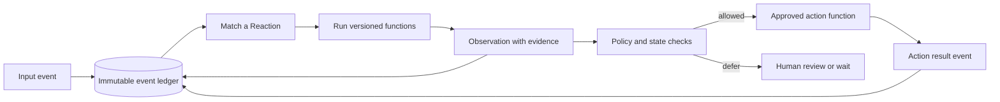

# REFLEX architecture

REFLEX is an event-driven workflow system. It turns an input event into a traceable observation, checks whether a response is allowed, and records any action and result as more events.

## Main flow

Every event keeps its identity and event time. Derived observations and action results are new events, so the input history stays intact. Replaying the same event does not repeat a completed action when its idempotency key already exists.

## Core parts

- **Event**: immutable fact with a timestamp, type, source, entity IDs, and attributes.
- **Lens**: versioned function that extracts a pattern or score from events.
- **Observation**: finding with evidence references and a confidence or result value.
- **Policy**: checks permissions, current state, and resource limits before work proceeds.
- **Reaction**: versioned workflow that connects event matching, functions, state, and outputs.
- **Action executor**: allowlisted boundary for actions. It records success or failure as an event.
- **State store**: versions named state updates and writes an audit reason and time.

The event ledger uses DuckDB. Durable state and candidate-lens transitions use SQLite. Statistical model artifacts store their feature schema, training boundary, calibration data, seed, and content hash.

## Time and evidence boundaries

Training, calibration, and evaluation use chronological splits. Training data fits models. Calibration data chooses thresholds. Later events measure performance. Hidden synthetic labels stay in a separate evaluator object and do not enter the adapter input.

The held-out experiment scores exact event IDs. Evidence checks confirm that a reference is in the same input, shares an entity with the prediction, and is not from the future. Those checks measure trace consistency; they do not prove that the cited events cause the outcome.

## Where the implementation lives

| Code | Responsibility |
|---|---|
| `src/reflex/core/models/base.py` | Shared immutable record behavior |
| `src/reflex/core/models/events.py` | Input events, observations, action requests/results, and stable IDs |
| `src/reflex/core/models/lenses.py` | Lens versions, observations, and Lens-candidate lifecycle |
| `src/reflex/core/models/policy.py` | Policy decisions and evidence-backed hypotheses |
| `src/reflex/core/models/features.py` | Typed event-window feature summaries |
| `src/reflex/contracts/reactions.py` | Versioned Reaction functions, nodes, edges, and graph validation |
| `src/reflex/contracts/schemas.py` | Exploratory observation type and persistent schema registry |
| `src/reflex/experiments/models/inputs.py` | Experiment settings, visible inputs, and hidden truth labels |
| `src/reflex/experiments/models/results.py` | Adapter outputs, per-variant runs, and experiment reports |
| `src/reflex/core/storage.py` | Event history and versioned state/audit storage |
| `src/reflex/core/features.py` | Chronological event and entity-window features |
| `src/reflex/core/discovery.py` | Model fitting, calibration, artifact loading, and scores |
| `src/reflex/core/policy.py` | Permission checks, bounded tools, and investigation traces |
| `src/reflex/runtime.py` | Reaction matching, function execution, and result recording |
| `src/reflex/experiments/` | Synthetic cases, adapters, metrics, and dataset replayers |

The [plain-language guide](REFLEX-GUIDE.md) explains the concepts. The [core guide](core-guide.md) walks through the records, data boundaries, storage, feature windows, model fitting, policy, and extension points. The [experiment notes](REFLEX-EXPERIMENTS.md) list measured results and limits.

## Limits

- A statistical score or relationship is a lead for review. It is not proof of a cause.
- The local examples use synthetic data and simulated action systems.
- Public news ingestion does not provide article relevance labels or causal market evidence.
- External agent baselines need real, pinned runs before comparative claims can be made.
- The project is a single-machine research prototype, not a production banking system.
