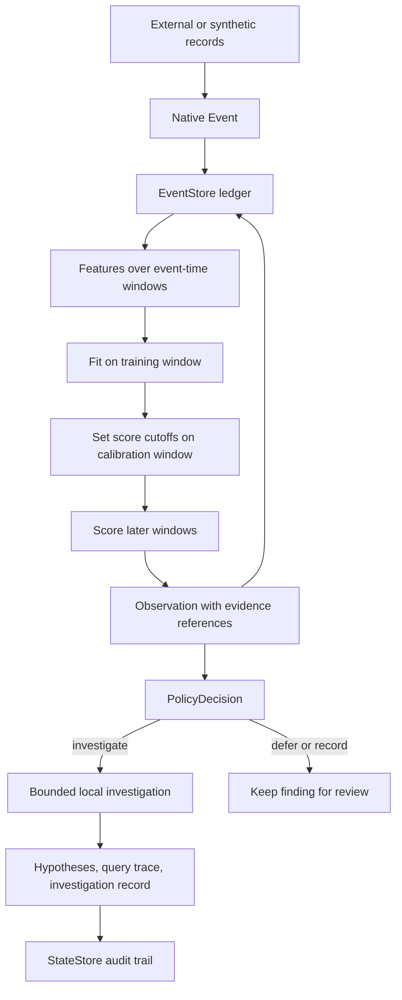

# REFLEX core guide

This guide is for people changing the event model, statistical discovery path, policy boundary, or local stores. It describes what the current code does and calls out where a research prototype should not be mistaken for a production guarantee.

## What the core is for

The core turns a time-ordered stream into durable, reviewable records. It keeps source facts, derived findings, and action records in one event vocabulary while storing operational state and lifecycle history separately.

The intended path is:



An `Observation` is a scored finding. It is not a verified anomaly, causal explanation, or permission to act. A `PolicyDecision` records the next allowed step. An `ActionEvent` records a request that a registered runtime may execute under its own permission checks.

## Core vocabulary

| Record | Meaning | Important fields |
|---|---|---|
| `Event` | Common immutable envelope | `event_id`, `event_type`, UTC `event_time`, `entity_ids`, attributes, source, provenance |
| `NativeEvent` | A fact received from an input source | `event_kind="native"` |
| `Observation` | A lens result with evidence and context | lens and model version, subject, window, score/value, supporting event IDs |
| `ObservationEvent` | An `Observation` represented in the event ledger | Parent IDs point back to the evidence events |
| `ActionEvent` | A request to call a named function | function name, arguments, permission name, retry limit |
| `ActionResultEvent` | A durable result of an action attempt | request ID, status, attempt number |
| `EventWindowFeatures` | A typed feature row for one entity and time window | interval, feature mapping, supporting IDs, cohort |
| `LensVersion` | A named, versioned detector definition | kind, version, feature schema, training cutoff and artifact reference |
| `LensCandidate` | A proposed SQL detector in a lifecycle | training and validation boundaries, limits, status, validation record |
| `PolicyDecision` | A reasoned routing choice | observation ID, action, policy version and reason |
| `Hypothesis` | A tentative explanation | statement, confidence, supporting and contradicting evidence IDs |

Most domain records inherit from `FrozenModel`. Pydantic validates their shape, model fields cannot be reassigned, and nested dictionaries/lists are frozen when the record is created. Convert records to JSON with `model_dump(mode="json")` when persisting or exchanging them.

## Event identity, time, and lineage

`Event` timestamps and `Observation` window bounds must include a timezone, and the models normalize them to UTC. Feature profiles should also require aware start and end times. Event-time windows use half-open bounds: an event is included when `start <= event_time < end`. Adjacent windows therefore do not double-count an event at their shared boundary.

Use a fresh UUID for a new fact. Use `stable_id(...)` when replaying the same logical result must reproduce the same ID. For example, statistical observations derive their ID from lens ID, model version, subject, and window. The event store treats a repeated ID with identical content as an idempotent replay. Reusing that ID for different content raises an error.

Lineage is explicit:

- `source` names the producer or lens.
- `provenance` records source-specific context, such as an input filename and row number or artifact path.
- `parent_event_ids` identify evidence or upstream records.
- `causation_id` identifies the immediate event that triggered a derived record when that relationship is meaningful.
- `correlation_id` groups records in the same broader workflow.
- `schema_ref` names the schema used for a derived payload.

These links support trace checks and replay. They do not prove that evidence caused an outcome.

## Ingestion: convert a source without hiding its origin

The reusable ingestion contract is simply `EventStore.add_events(events)`. A source adapter belongs beside the dataset or application that needs it. The BPI and Loghub file readers are now in `reflex.experiments.log_adapters`: BPI cases map to entity IDs and activities to event types, while remaining source columns stay in `attributes`. The readers preserve file and row, line, trace, or event references in provenance.

The adapters do not download data, infer business meaning, or repair arbitrary schemas. Add a source-specific adapter when the mapping is ambiguous. Keep the original field names where practical, document any normalization, and make entity and timestamp rules explicit. Validate the resulting event count and a few mapped records before using an unfamiliar source.

Example:

```python
from reflex.experiments.log_adapters import read_bpi2017
from reflex.core.storage import EventStore

store = EventStore("events.duckdb")
inserted = store.add_events(read_bpi2017("BPI Challenge 2017.csv"))
print(f"Inserted {inserted} source events")
store.close()
```

The parser assigns stable IDs based on file position for these adapters. If a source can reorder records between exports, add a stable source-native key before relying on replay deduplication.

## Event and state storage

### `EventStore`

`EventStore` uses DuckDB for the append-oriented event ledger. It stores the common event columns and kind-specific metadata, and it can reopen earlier databases by adding missing metadata columns. `add_events` writes a batch in a transaction. Either all newly inserted rows commit or the batch rolls back on error.

Read methods sort by `(event_time, event_id)`. `native_events()` excludes REFLEX-generated observations and actions, which is the safer default for fitting models from source data. `all_events()` includes the full history. SQL lenses go through `query_sql_lens`, which accepts one bounded `SELECT` or `WITH` statement and rejects common external-file access functions. The adapter does not parse SQL to enforce a strict relation allowlist, so only trusted lens definitions should reach it. This boundary is a local guardrail, not a hardened multi-tenant SQL sandbox.

`save_observations` writes a typed observation record and its `ObservationEvent` representation. Keeping the ledger event lets later processes follow evidence links using the same event IDs as the input stream. `export_parquet` writes an event-time-sorted snapshot for analysis.

### `StateStore`

`StateStore` uses SQLite for values that change over time: operational baselines, discovery summaries, hypotheses, lens candidates, investigation records, and per-run budgets. `set(namespace, key, value, reason)` increments a version and appends a transition record containing the reason. Read `audit()` when you need to understand how the current value was reached.

Use `snapshot()` for current values. `snapshot_at(namespace, as_of)` selects the newest recorded value at or before the requested time for records that carry an `as_of` timestamp. Records without `as_of` are treated as static/current configuration. Do not use a current value as if it were historical state unless the value has an explicit time boundary.

The stores are local single-machine components. Call `close()` when a process is finished with a store. The current implementation does not provide distributed transactions across DuckDB and SQLite, retention policies, multi-tenant access control, or a production backup strategy.

## Feature rows and experiment-owned windowing

The core defines the `EventWindowFeatures` record and a generic `matrix(rows, names)` conversion. It does not decide how a domain's events should be grouped or what values count as useful features. Application code can build its own `EventWindowFeatures` rows from any source events and pass the chosen feature-name order to `fit_lenses`.

The current transaction experiment profile lives in `reflex.experiments.transaction_features`. It supplies `build_transaction_windows` and `TRANSACTION_FEATURE_NAMES`. These features assume fields such as amount, channel, region, and latency. Several absent numeric fields default to zero and absent categories to `unknown`. Those choices are specific to that profile, not core semantics.

When adding another domain profile, explicitly map its subject and time semantics, decide whether a missing measurement means zero or unknown, retain supporting event IDs, and document units. Pass its schema to fitting and reuse the same ordered schema at scoring time. The artifact stores this list so feature assumptions are visible.

### Reusable core call

An application can supply any finite numeric feature schema. The core call does not import a dataset reader or assume that an attribute is named `amount`:

```python
from reflex.core.discovery import fit_lenses, score_rows
from reflex.core.models.features import EventWindowFeatures

feature_names = ("request_rate", "latency_p95", "error_share")

# The application owns how events become these rows and their supporting IDs.
training_rows: list[EventWindowFeatures] = build_rows(training_events)
calibration_rows: list[EventWindowFeatures] = build_rows(calibration_events)
holdout_rows: list[EventWindowFeatures] = build_rows(holdout_events)

lenses = fit_lenses(training_rows, calibration_rows, "artifacts/service-v1",
                    feature_names=feature_names)
observations = score_rows(holdout_rows, lenses)
```

The named `build_rows` function is supplied by the application. REFLEX's transaction example is one such profile, located in `reflex.experiments.transaction_features`.

## Statistical discovery and the training boundary

`fit_lenses(training_rows, calibration_rows, ..., feature_names=...)` is a schema-driven statistical path:

1. Fit `StandardScaler` using training rows only.
2. Transform training and calibration rows using that fitted scaler.
3. Train an autoencoder to reconstruct training rows.
4. Fit an Isolation Forest on the same standardized training rows.
5. Score calibration rows with both detectors.
6. Set each detector's cutoff to the `1 - contamination` quantile of its calibration scores.
7. Save model, preprocessing, feature schema, configuration, boundaries, and row signatures.

If `feature_names` is omitted, the first training row supplies the insertion-ordered names. Application callers should pass an explicit schema rather than relying on dictionary order.

`score_rows` applies the frozen scaler and models to later rows. It creates one `Observation` per lens per row. The autoencoder score is mean squared reconstruction residual. The Isolation Forest score is the negated `decision_function`, so larger values are more unusual. `is_anomaly` means only that the score is at or above the stored calibration cutoff.

The nominal contamination parameter does not guarantee a fixed alert rate after calibration. Tied calibration scores can put many records exactly at the cutoff, and later distribution changes can move far more or fewer scores past it. Inspect alert counts and ties on a chronological holdout before choosing an operational review policy. Do not tune cutoffs against hidden test labels.

`load_lenses` verifies the version digest recorded for the autoencoder and forest files before rebuilding the runtime objects. Keep the manifest and preprocessing file beside those artifacts. Treat generated artifacts as trusted local files; loading a serialized joblib object from an untrusted source can execute code.

`cluster_observations` groups already-flagged observations by their standardized scores and feature values. A cluster is a way to organize review. It is not a second detector, a statistical significance test, or an explanation of why the events occurred.

Example with explicit chronological boundaries:

```python
from reflex.core.discovery import fit_lenses, score_rows
from reflex.experiments.transaction_features import build_transaction_windows, TRANSACTION_FEATURE_NAMES

training = build_transaction_windows(events, start=start, end=train_end)
calibration = build_transaction_windows(events, start=train_end, end=calibration_end)
holdout = build_transaction_windows(events, start=calibration_end, end=end)

lenses = fit_lenses(training, calibration, "artifacts/run-001",
                    training_cutoff=train_end,
                    feature_names=TRANSACTION_FEATURE_NAMES)
observations = score_rows(holdout, lenses)
```

## Deterministic SQL lenses and candidate review

`SqlLens` wraps a versioned SQL definition. `replay()` asks `EventStore` to execute the bounded query and converts each selected row into an `Observation` with the matching source event ID as evidence. SQL lenses are useful when the pattern is explicit and auditable, such as a threshold breach. They do not require model training. The high-amount example query lives in `reflex.experiments.transaction_lenses`; there is no transaction default in the core Lens class.

Proposed SQL lenses use a separate candidate lifecycle:

```text
proposed -> testing -> validated -> approved -> active -> retired
       \-> rejected <-/       \---------------------> retired
```

`BoundedTools.validate_lens` checks that the SQL runs within row limits, validation starts at or after the declared unseen boundary, outputs include `event_id`, and the candidate is not almost identical to an active SQL lens. It compares output counts over two subwindows and cohort counts as diagnostics. Since there are no independent labels in that validator, it leaves the false-positive rate unknown. A valid query is not the same thing as a useful lens.

Approval and activation are distinct lifecycle transitions. Validation records evidence for a human decision. It does not automatically activate a candidate or establish that the candidate detects a real anomaly.

## Policy and bounded investigation

`PolicyEngine` is intentionally deterministic. A non-flagged observation is recorded. A flagged observation is routed to investigation while the run's investigation budget remains, then deferred when that budget is exhausted. It does not decide that a finding is true, and it does not execute a business action.

`BoundedTools` exposes a fixed set of local operations: inspect observations, query a time-bounded set of native events, compare cohort summaries, inspect state, validate a candidate lens, and record a hypothesis. Each operation consumes a persisted query allowance and appends a trace entry. The tools accept data and parameters rather than arbitrary user-supplied Python code.

`LocalInvestigator` is a no-model fallback. It gathers the observation, nearby supporting events, a state snapshot, and two rival hypotheses. A caller may inject a profile-specific feature selector to add the fixed cohort comparison. With no selector, the core does not guess which feature is meaningful for the domain. Its confidence values are placeholders for structured review and are not calibrated probabilities. Its output explicitly remains deferred for human review.

An `ActionEvent` is a request record. A separate runtime must resolve its function through an allowlist, check permission and policy, enforce idempotency, and write an `ActionResultEvent`. Keep external side effects behind that runtime boundary; do not make a lens or investigator call an external system directly.

## Evaluation and honest reporting

The synthetic generator stores hidden labels in a separate evaluator directory. The ordinary event manifest and event attributes do not carry those labels. The discovery path accepts the evaluator directory only as an explicit option and reads labels after producing observations.

`score_synthetic_run` measures two different units:

- An observation is counted as a true-positive observation if it covers at least one labeled event for the same subject and its time window.
- A hidden event is counted as recovered once, even if multiple observations cover it.

It also reports mechanism coverage. Therefore `true_positive_observations`, recovered event count, and event recall are related but not interchangeable metrics. The scorer evaluates generated labels, not analyst judgments about whether a real alert is important.

The manual A–E benchmark functions record externally run variants. `protocol_manifest` creates the protocol, `append_run_record` validates budget and identity fields, and `protocol_report` summarizes only recorded runs. A manifest with no records is a blank protocol, not a benchmark result.

## Extending the core

### Add a source adapter

Add a focused reader beside the dataset or application profile that needs it. Yield validated `Event` instances, normalize event times to aware UTC timestamps, preserve source identifiers, and record enough provenance to find the original row. The generic core only receives normalized events. Avoid putting evaluation labels in event attributes.

### Add a feature

Add features in the relevant domain profile, not to `core/features.py`. Document each unit, missing-value behavior, temporal boundary, and intended domain. Pass the feature-name order into `fit_lenses` and keep it with every artifact.

### Add a lens

For a statistical lens, define how it fits only on training rows, how its cutoff is chosen using only calibration rows, and how it handles absent features. Preserve its version and evidence IDs in every `Observation`. For a deterministic SQL lens, use `query_sql_lens` and return event IDs. Never report a statistical association as causation.

### Add a policy route

Represent the route as a `PolicyDecision` with a policy ID, version, and explanation. Enforce run budgets in `StateStore`. For external actions, route through the runtime's registered function boundary and retain the request, idempotency key, permission, attempt, and outcome as events.

## Compatibility imports

`core.features` still lazily exposes the old transaction feature names. `core.synthetic`, `core.evaluation`, and `core.ingestion` are small compatibility bridges, and `core.lenses.DEFAULT_SQL` exposes the former sample query. The root `reflex.ingestion`, `reflex.news_demo`, and `reflex.benchmark` imports also forward to their experiment modules. New code should use the explicit modules under `reflex.experiments`. These bridges preserve existing local imports while keeping core implementations independent of experiment profiles.

## Running core operations and experiment profiles

From the repository root:

```bash
# Generate transaction-shaped experiment data with labels stored separately.
uv run reflex experiments discovery generate --out .reflex-demo --seed 11

# Run discovery without opening the evaluator directory.
uv run reflex experiments discovery run --data-dir .reflex-demo

# Run the synthetic end-to-end example with post-run evaluation.
uv run reflex experiments discovery demo --out .reflex-demo --seed 11

# Dataset-specific ingestion uses the experiment adapter.
uv run reflex experiments ingest-bpi "BPI Challenge 2017.csv" --db events.duckdb

# Core replay requires a caller-supplied SQL Lens.
uv run reflex replay --db events.duckdb --state state.sqlite --sql-file lens.sql

# Or replay the transaction example profile.
uv run reflex experiments transaction-replay --db events.duckdb --state state.sqlite
```

Generated local stores and artifacts are intended for inspection and experiments. The current code is a research prototype. It lacks production controls such as authenticated multi-user access, a hardened SQL isolation boundary, schema evolution policy, monitoring, backups, and independent real-world validation.

## Core code map

| File | Responsibilities |
|---|---|
| `src/reflex/core/models/base.py` | Immutable, validated record base and recursive container freezing |
| `src/reflex/core/models/events.py` | Native, observation, and action event shapes plus replay-safe IDs |
| `src/reflex/core/models/features.py` | Typed feature row contract |
| `src/reflex/core/models/lenses.py` | Lens definitions, findings, and candidate lifecycle |
| `src/reflex/core/models/policy.py` | Policy decisions and evidence-linked hypotheses |
| `src/reflex/core/ingestion.py` | Compatibility imports only; dataset readers live in experiments |
| `src/reflex/core/storage.py` | DuckDB event ledger and SQLite state/audit/budget store |
| `src/reflex/core/features.py` | Generic feature row to matrix conversion |
| `src/reflex/core/discovery.py` | Schema-driven training, calibration, artifact persistence, scoring, clustering |
| `src/reflex/core/lenses.py` | Deterministic SQL lens replay |
| `src/reflex/core/policy.py` | Decision routing and fixed bounded investigation operations |
| `src/reflex/experiments/transaction_features.py` | Transaction-only window feature profile |
| `src/reflex/experiments/log_adapters.py` | BPI and Loghub dataset file readers |
| `src/reflex/experiments/synthetic_data.py` | Seeded synthetic stream and hidden labels |
| `src/reflex/experiments/evaluation.py` | Synthetic-label scoring and manual benchmark records |
| `src/reflex/experiments/local_discovery.py` | Example workflow composing transaction profile with core APIs |
| `src/reflex/core/cli.py` | Reusable event, SQL Lens, and state commands |
| `src/reflex/runtime.py` | Reaction matching and registered action execution boundary |
